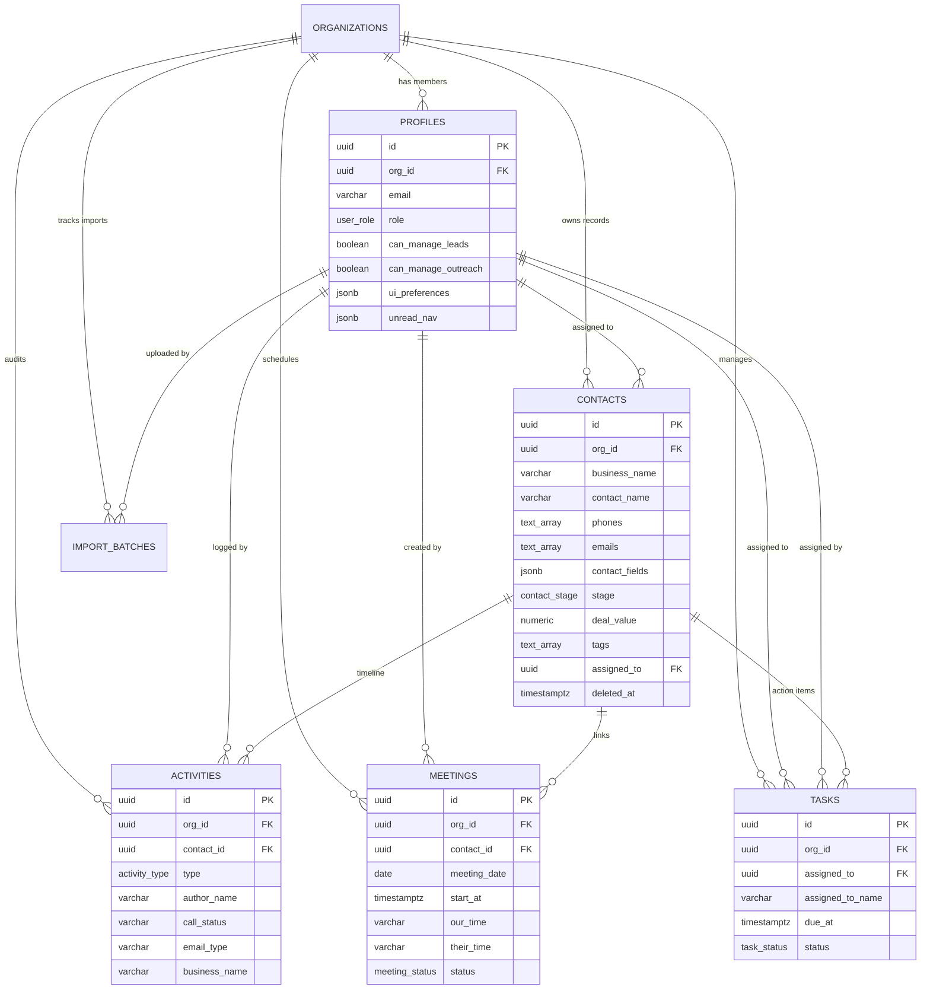

# TeraFlow CRM — Backend & Database Architecture Blueprint

**Document Version:** 2.1.0 (Frontend Synchronized & Production Verified)  
**Target Environment:** PostgreSQL 15+ / Supabase / Next.js 16 (Turbopack, App Router)  
**Author:** Senior Full-Stack Software Architect & Database Engineering Lead  

---

## Executive Summary

TeraFlow CRM is a high-velocity, desktop-grade Customer Relationship Management platform. This document defines the **end-to-end backend architecture, production-grade PostgreSQL DDL, indexing matrix, Row-Level Security (RLS) policies, Supabase Storage buckets, Prisma schema, and Next.js 16 App Router API contracts**.

### Key Architectural Objectives & Frontend Alignments
1. **Direct 1:1 Schema Compatibility with Frontend Types:** Zero impedance mismatch between database tables and frontend interfaces (`Person`, `Meeting`, `Task`, `UserProfile`, `PersonActivity`, `MetricData`).
2. **Sub-Millisecond SLAs at Scale:** Single-digit millisecond query response times achieved via targeted composite B-trees, GIN trigram text search, and GIN array containment indexing.
3. **Database-Enforced Business Invariants:**
   - Strict single Team Lead per organization enforced via partial unique index (`uq_org_single_team_lead`).
   - Tenant isolation on all tables enforced by PostgreSQL Row-Level Security (`org_id`).
   - Role-Based Access Control where Team Leads possess full administrative authority and Team Members are action-gated via explicit boolean permissions (`can_manage_leads`, `can_manage_outreach`, etc.).
4. **Persistent Taxonomies & UI State:** Global tags, custom niches, custom cities, sidebar collapse preferences, and unread navigation indicators are persisted in the database rather than ephemeral browser storage.
5. **Non-Destructive Activity & Outreach Audit Trails:** Call logs and email outreach records are preserved with snapshots even if contacts are soft-deleted or removed.
6. **Realtime Collaborative Sync:** Automated Supabase Realtime replication for instant taskbar, meeting, and outreach updates across team members.

---

## 1. Normalized Database Schema (PostgreSQL DDL)

This DDL script is migration-ready. It includes:
- UUID primary keys with automatic generation.
- Exact enums matching TeraFlow's pipeline stages, statuses, roles, and activity types.
- Multi-channel communication arrays (`phones TEXT[]`, `emails TEXT[]`) and JSONB custom contact fields (`contact_fields`) on contacts, eliminating slow N+1 joins when rendering table views.
- High-performance soft-delete columns (`deleted_at`) with partial indexes.

```sql
-- ═══════════════════════════════════════════════════════════════════════════
-- EXTENSIONS & CORE FUNCTIONS
-- ═══════════════════════════════════════════════════════════════════════════
CREATE EXTENSION IF NOT EXISTS "uuid-ossp";
CREATE EXTENSION IF NOT EXISTS "pg_trgm";

-- Automated updated_at timestamp trigger function
CREATE OR REPLACE FUNCTION set_updated_at()
RETURNS TRIGGER AS $$
BEGIN
    NEW.updated_at = NOW();
    RETURN NEW;
END;
$$ LANGUAGE plpgsql;

-- ═══════════════════════════════════════════════════════════════════════════
-- 1. ORGANIZATIONS (Tenant Boundary & Shared Catalogs)
-- ═══════════════════════════════════════════════════════════════════════════
CREATE TABLE organizations (
    id UUID PRIMARY KEY DEFAULT uuid_generate_v4(),
    name VARCHAR(255) NOT NULL,
    slug VARCHAR(100) UNIQUE NOT NULL,
    
    -- Shared Dynamic CRM Catalogs (Persisted across all team members)
    custom_niches TEXT[] NOT NULL DEFAULT '{}',
    custom_cities TEXT[] NOT NULL DEFAULT '{}',
    global_tags TEXT[] NOT NULL DEFAULT '{}',

    created_at TIMESTAMPTZ NOT NULL DEFAULT NOW(),
    updated_at TIMESTAMPTZ NOT NULL DEFAULT NOW()
);

CREATE TRIGGER trg_organizations_updated_at
BEFORE UPDATE ON organizations
FOR EACH ROW EXECUTE FUNCTION set_updated_at();

-- ═══════════════════════════════════════════════════════════════════════════
-- 2. PROFILES (1:1 with Supabase auth.users)
-- ═══════════════════════════════════════════════════════════════════════════
CREATE TYPE user_role AS ENUM ('Team Lead', 'Team Member');
CREATE TYPE user_status AS ENUM ('active', 'invited', 'inactive');
CREATE TYPE theme_mode AS ENUM ('light', 'dark');

CREATE TABLE profiles (
    id UUID PRIMARY KEY REFERENCES auth.users(id) ON DELETE CASCADE,
    org_id UUID NOT NULL REFERENCES organizations(id) ON DELETE CASCADE,
    name VARCHAR(255) NOT NULL,
    email VARCHAR(255) UNIQUE NOT NULL,
    role user_role NOT NULL DEFAULT 'Team Member',
    title VARCHAR(100) DEFAULT '',
    phone VARCHAR(50) DEFAULT '',
    avatar_url TEXT,
    status user_status NOT NULL DEFAULT 'active',
    theme theme_mode NOT NULL DEFAULT 'dark',

    -- Granular Permissions (Team Lead automatically bypasses these)
    can_manage_leads BOOLEAN NOT NULL DEFAULT FALSE,
    can_manage_outreach BOOLEAN NOT NULL DEFAULT FALSE,
    can_manage_tasks BOOLEAN NOT NULL DEFAULT FALSE,
    can_manage_meetings BOOLEAN NOT NULL DEFAULT FALSE,
    can_import_data BOOLEAN NOT NULL DEFAULT FALSE,
    can_export_data BOOLEAN NOT NULL DEFAULT FALSE,

    -- UI State & Notification Memory (Persists expanded bars & unread dots)
    ui_preferences JSONB NOT NULL DEFAULT '{"navExpanded": true, "taskbarExpanded": true}'::jsonb,
    unread_nav JSONB NOT NULL DEFAULT '{"Meetings": false, "Tasks": false, "People": false, "Call Log": false, "Email Outreach": false, "Imports": false, "Teams": false, "Settings": false, "Dashboard": false}'::jsonb,

    created_at TIMESTAMPTZ NOT NULL DEFAULT NOW(),
    updated_at TIMESTAMPTZ NOT NULL DEFAULT NOW()
);

-- Business Invariant: Exactly ONE Team Lead allowed per organization
CREATE UNIQUE INDEX uq_org_single_team_lead 
ON profiles (org_id) 
WHERE role = 'Team Lead';

CREATE TRIGGER trg_profiles_updated_at
BEFORE UPDATE ON profiles
FOR EACH ROW EXECUTE FUNCTION set_updated_at();

-- ═══════════════════════════════════════════════════════════════════════════
-- 3. CONTACTS / PEOPLE (Unified CRM Pipeline Entity)
-- ═══════════════════════════════════════════════════════════════════════════
CREATE TYPE contact_stage AS ENUM (
    'New Leads',
    'Contacted',
    'Booked',
    'Closed',
    'Follow-Up',
    'Denied',
    'Past Clients'
);

CREATE TYPE contact_priority AS ENUM ('Low', 'Medium', 'High');

CREATE TABLE contacts (
    id UUID PRIMARY KEY DEFAULT uuid_generate_v4(),
    org_id UUID NOT NULL REFERENCES organizations(id) ON DELETE CASCADE,
    
    business_name VARCHAR(255) NOT NULL,
    contact_name VARCHAR(255) DEFAULT '',
    first_name VARCHAR(100),
    last_name VARCHAR(100),
    
    -- Fast Indexed Communication Channels
    primary_email VARCHAR(255),
    primary_phone VARCHAR(50),
    
    -- Multi-Channel Arrays matching frontend interface: phones: string[], emails: string[]
    phones TEXT[] NOT NULL DEFAULT '{}',
    emails TEXT[] NOT NULL DEFAULT '{}',
    
    -- Custom Contact Channels (Website, LinkedIn, Instagram, Facebook, Address)
    -- Stored as: [{"id": "cf-1", "type": "linkedin", "label": "LinkedIn", "value": "https://..."}]
    contact_fields JSONB NOT NULL DEFAULT '[]'::jsonb,
    
    -- Pipeline Metadata
    stage contact_stage NOT NULL DEFAULT 'New Leads',
    priority contact_priority NOT NULL DEFAULT 'Medium',
    source VARCHAR(100) NOT NULL DEFAULT 'Cold Outreach',
    deal_value NUMERIC(12, 2) NOT NULL DEFAULT 0.00,
    
    -- Segmentation
    niche VARCHAR(100) NOT NULL,
    city VARCHAR(100) NOT NULL,
    tags TEXT[] NOT NULL DEFAULT '{}',
    
    -- Ownership & Notes
    assigned_to UUID REFERENCES profiles(id) ON DELETE SET NULL,
    notes TEXT DEFAULT '',
    
    -- Denormalized cache for lightning-fast table renders
    last_contacted_at TIMESTAMPTZ,
    last_activity_type VARCHAR(50),
    last_activity_summary TEXT,

    -- Soft Deletion (Trash preservation)
    deleted_at TIMESTAMPTZ DEFAULT NULL,
    created_at TIMESTAMPTZ NOT NULL DEFAULT NOW(),
    updated_at TIMESTAMPTZ NOT NULL DEFAULT NOW()
);

CREATE TRIGGER trg_contacts_updated_at
BEFORE UPDATE ON contacts
FOR EACH ROW EXECUTE FUNCTION set_updated_at();

-- ═══════════════════════════════════════════════════════════════════════════
-- 4. ACTIVITIES & OUTREACH AUDIT (Timeline, Call Logs, Emails)
-- ═══════════════════════════════════════════════════════════════════════════
-- Fully synchronized with frontend ActivityType:
-- 'call' | 'email' | 'stage_change' | 'tag_added' | 'tag_removed' | 'note' | 'contact_info' | 'name_change' | 'task'
CREATE TYPE activity_type AS ENUM (
    'call',
    'email',
    'note',
    'stage_change',
    'tag_added',
    'tag_removed',
    'contact_info',
    'name_change',
    'task'
);

CREATE TABLE activities (
    id UUID PRIMARY KEY DEFAULT uuid_generate_v4(),
    org_id UUID NOT NULL REFERENCES organizations(id) ON DELETE CASCADE,
    -- SET NULL ensures call logs & emails are preserved even if the contact is deleted
    contact_id UUID REFERENCES contacts(id) ON DELETE SET NULL,
    author_id UUID NOT NULL REFERENCES profiles(id) ON DELETE CASCADE,
    author_name VARCHAR(255) NOT NULL DEFAULT 'Muhammad Taqi',
    
    type activity_type NOT NULL,
    title VARCHAR(255) NOT NULL,
    description TEXT DEFAULT '',
    
    -- Fast Snapshot Fields (Preserved for CallsView & OutreachView)
    business_name VARCHAR(255) NOT NULL,
    contact_name VARCHAR(255) DEFAULT '',
    phone VARCHAR(50) DEFAULT '',
    email VARCHAR(255) DEFAULT '',
    
    -- Call & Email Specific Metadata
    call_status VARCHAR(50),        -- 'Answered', 'Not answered', 'Call failed', 'Busy', 'Left Voicemail', 'Wrong Number'
    call_duration_seconds INT,
    email_type VARCHAR(20),         -- 'Sent', 'Reply'
    email_subject VARCHAR(255),
    
    created_at TIMESTAMPTZ NOT NULL DEFAULT NOW(),
    updated_at TIMESTAMPTZ NOT NULL DEFAULT NOW()
);

CREATE TRIGGER trg_activities_updated_at
BEFORE UPDATE ON activities
FOR EACH ROW EXECUTE FUNCTION set_updated_at();

-- ═══════════════════════════════════════════════════════════════════════════
-- 5. MEETINGS
-- ═══════════════════════════════════════════════════════════════════════════
CREATE TYPE meeting_status AS ENUM (
    'Scheduled',
    'Not attended',
    'Deal Done',
    'Deal Denied',
    'Other'
);

CREATE TABLE meetings (
    id UUID PRIMARY KEY DEFAULT uuid_generate_v4(),
    org_id UUID NOT NULL REFERENCES organizations(id) ON DELETE CASCADE,
    contact_id UUID REFERENCES contacts(id) ON DELETE SET NULL,
    created_by UUID NOT NULL REFERENCES profiles(id) ON DELETE CASCADE,
    
    business_name VARCHAR(255) NOT NULL,
    client_name VARCHAR(255) NOT NULL,
    email VARCHAR(255) NOT NULL,
    phone VARCHAR(50) NOT NULL,
    
    -- World Cities & Timezone Metadata (From ScheduleMeetingModal)
    city VARCHAR(100) DEFAULT 'New York',
    timezone VARCHAR(100) DEFAULT 'America/New_York',
    
    meeting_date DATE NOT NULL,
    start_at TIMESTAMPTZ,               -- Normalized UTC timestamp for indexing & calendar sync
    our_time VARCHAR(50) NOT NULL,      -- Display string e.g. "03:00 PM PKT"
    their_time VARCHAR(50) NOT NULL,    -- Display string e.g. "06:00 AM EST"
    status meeting_status NOT NULL DEFAULT 'Scheduled',
    notes TEXT DEFAULT '',
    meeting_link TEXT,
    
    deleted_at TIMESTAMPTZ DEFAULT NULL,
    created_at TIMESTAMPTZ NOT NULL DEFAULT NOW(),
    updated_at TIMESTAMPTZ NOT NULL DEFAULT NOW()
);

CREATE TRIGGER trg_meetings_updated_at
BEFORE UPDATE ON meetings
FOR EACH ROW EXECUTE FUNCTION set_updated_at();

-- ═══════════════════════════════════════════════════════════════════════════
-- 6. TASKS
-- ═══════════════════════════════════════════════════════════════════════════
CREATE TYPE task_status AS ENUM ('TODO', 'COMPLETED');

CREATE TABLE tasks (
    id UUID PRIMARY KEY DEFAULT uuid_generate_v4(),
    org_id UUID NOT NULL REFERENCES organizations(id) ON DELETE CASCADE,
    contact_id UUID REFERENCES contacts(id) ON DELETE SET NULL,
    
    title VARCHAR(255) NOT NULL,
    description TEXT DEFAULT '',
    
    assigned_by UUID NOT NULL REFERENCES profiles(id) ON DELETE CASCADE,
    assigned_to UUID NOT NULL REFERENCES profiles(id) ON DELETE CASCADE,
    assigned_by_name VARCHAR(255) NOT NULL DEFAULT 'Muhammad Taqi',
    assigned_to_name VARCHAR(255) NOT NULL DEFAULT 'Muhammad Taqi',
    
    due_date DATE NOT NULL,
    due_time VARCHAR(10) NOT NULL DEFAULT '17:00', -- HH:mm
    due_at TIMESTAMPTZ NOT NULL,                   -- Normalized timestamp for index sorting
    
    status task_status NOT NULL DEFAULT 'TODO',
    completion_comment TEXT,
    completed_at TIMESTAMPTZ,
    
    deleted_at TIMESTAMPTZ DEFAULT NULL,
    created_at TIMESTAMPTZ NOT NULL DEFAULT NOW(),
    updated_at TIMESTAMPTZ NOT NULL DEFAULT NOW()
);

CREATE TRIGGER trg_tasks_updated_at
BEFORE UPDATE ON tasks
FOR EACH ROW EXECUTE FUNCTION set_updated_at();

-- ═══════════════════════════════════════════════════════════════════════════
-- 7. IMPORT BATCHES (Audited Ingestion History)
-- ═══════════════════════════════════════════════════════════════════════════
CREATE TABLE import_batches (
    id UUID PRIMARY KEY DEFAULT uuid_generate_v4(),
    org_id UUID NOT NULL REFERENCES organizations(id) ON DELETE CASCADE,
    imported_by UUID NOT NULL REFERENCES profiles(id) ON DELETE CASCADE,
    
    filename VARCHAR(255) NOT NULL,
    file_url TEXT,
    total_records INT NOT NULL DEFAULT 0,
    successful_records INT NOT NULL DEFAULT 0,
    failed_records INT NOT NULL DEFAULT 0,
    
    default_niche VARCHAR(100),
    default_city VARCHAR(100),
    default_stage contact_stage NOT NULL DEFAULT 'New Leads',
    applied_tags TEXT[] DEFAULT '{}',
    
    created_at TIMESTAMPTZ NOT NULL DEFAULT NOW()
);
```

---

## 2. High-Frequency Indexing Strategy (Sub-Millisecond SLAs)

In a high-velocity CRM, slow queries occur when filtering multi-tenant datasets or executing full-table scans for fuzzy text search. The matrix below guarantees sub-millisecond execution plans:

```sql
-- 1. Pipeline Smart Lists & Keyset Pagination (Excludes soft-deleted records)
-- Solves: WHERE org_id = $1 AND deleted_at IS NULL AND stage = $2 ORDER BY created_at DESC
CREATE INDEX idx_contacts_org_stage_active 
ON contacts (org_id, stage, created_at DESC) 
WHERE deleted_at IS NULL;

-- 2. Owner Filtering (Sales Rep workload view)
-- Solves: WHERE org_id = $1 AND assigned_to = $2 AND deleted_at IS NULL
CREATE INDEX idx_contacts_org_assigned 
ON contacts (org_id, assigned_to, stage) 
WHERE deleted_at IS NULL;

-- 3. GIN Array Index for Instant Multi-Tag Filters
-- Solves: WHERE org_id = $1 AND tags @> ARRAY['VIP', 'Warm']
CREATE INDEX idx_contacts_tags_gin 
ON contacts USING GIN (tags);

-- 4. Trigram Fuzzy Search Indexes (Type-ahead search across names)
-- Solves: WHERE org_id = $1 AND business_name ILIKE '%dental%'
CREATE INDEX idx_contacts_biz_trgm 
ON contacts USING GIN (business_name gin_trgm_ops);

CREATE INDEX idx_contacts_name_trgm 
ON contacts USING GIN (contact_name gin_trgm_ops);

-- 5. Functional Indexes for Case-Insensitive Deduplication & Lookups
CREATE INDEX idx_contacts_email_lower 
ON contacts (org_id, LOWER(primary_email)) 
WHERE primary_email IS NOT NULL AND deleted_at IS NULL;

CREATE INDEX idx_contacts_phone 
ON contacts (org_id, primary_phone) 
WHERE primary_phone IS NOT NULL AND deleted_at IS NULL;

-- 6. Taskbar Performance (Urgent active tasks first)
-- Solves: WHERE org_id = $1 AND status = 'TODO' AND deleted_at IS NULL ORDER BY due_at ASC
CREATE INDEX idx_tasks_org_active_due 
ON tasks (org_id, due_at ASC) 
WHERE status = 'TODO' AND deleted_at IS NULL;

-- 7. Call Log & Email Outreach List Queries (CallsView & OutreachView)
-- Solves: WHERE org_id = $1 AND type = 'call' ORDER BY created_at DESC
CREATE INDEX idx_activities_org_type_created 
ON activities (org_id, type, created_at DESC);

-- 8. Activity Timeline (Contact Details Drawer)
-- Solves: WHERE contact_id = $1 ORDER BY created_at DESC
CREATE INDEX idx_activities_contact_created 
ON activities (contact_id, created_at DESC);

-- 9. Meetings Calendar Lookups & Normalized UTC Range Search
-- Solves: WHERE org_id = $1 AND meeting_date = CURRENT_DATE AND deleted_at IS NULL
CREATE INDEX idx_meetings_org_date_status 
ON meetings (org_id, meeting_date, status) 
WHERE deleted_at IS NULL;

CREATE INDEX idx_meetings_org_start_at 
ON meetings (org_id, start_at ASC) 
WHERE deleted_at IS NULL;
```

---

## 3. Entity Relationship Diagram (ERD)



---

## 4. Row-Level Security (RLS) & Multi-Tenant Blueprint

```sql
-- 1. Enable RLS on every table
ALTER TABLE organizations ENABLE ROW LEVEL SECURITY;
ALTER TABLE profiles ENABLE ROW LEVEL SECURITY;
ALTER TABLE contacts ENABLE ROW LEVEL SECURITY;
ALTER TABLE activities ENABLE ROW LEVEL SECURITY;
ALTER TABLE meetings ENABLE ROW LEVEL SECURITY;
ALTER TABLE tasks ENABLE ROW LEVEL SECURITY;
ALTER TABLE import_batches ENABLE ROW LEVEL SECURITY;

-- 2. Security Definier Helper: Retrieves authenticated profile in a single cached call
CREATE OR REPLACE FUNCTION get_current_profile()
RETURNS profiles
LANGUAGE sql
STABLE
SECURITY DEFINER
SET search_path = public
AS $$
    SELECT * FROM profiles WHERE id = auth.uid();
$$;

-- 3. PROFILES POLICIES
-- All members can read colleague names/roles in their organization
CREATE POLICY "Profiles Org Read" ON profiles
FOR SELECT USING (org_id = (get_current_profile()).org_id);

-- Members can only update their own personal details; only Team Lead can update roles/permissions
CREATE POLICY "Profiles Update Scope" ON profiles
FOR UPDATE USING (
    org_id = (get_current_profile()).org_id
    AND (
        (get_current_profile()).role = 'Team Lead'
        OR id = auth.uid()
    )
);

-- 4. CONTACTS POLICIES
-- Team Lead has unrestricted access; Team Member requires can_manage_leads permission
CREATE POLICY "Contacts MultiTenant Access" ON contacts
FOR ALL USING (
    org_id = (get_current_profile()).org_id
    AND (
        (get_current_profile()).role = 'Team Lead'
        OR (get_current_profile()).can_manage_leads = TRUE
    )
);

-- 5. ACTIVITIES POLICY (Call logs, Emails, Notes)
CREATE POLICY "Activities Access" ON activities
FOR ALL USING (
    org_id = (get_current_profile()).org_id
    AND (
        (get_current_profile()).role = 'Team Lead'
        OR (get_current_profile()).can_manage_outreach = TRUE
    )
);

-- 6. MEETINGS POLICY
CREATE POLICY "Meetings Access" ON meetings
FOR ALL USING (
    org_id = (get_current_profile()).org_id
    AND (
        (get_current_profile()).role = 'Team Lead'
        OR (get_current_profile()).can_manage_meetings = TRUE
    )
);

-- 7. TASKS POLICY
CREATE POLICY "Tasks Access" ON tasks
FOR ALL USING (
    org_id = (get_current_profile()).org_id
    AND (
        (get_current_profile()).role = 'Team Lead'
        OR (get_current_profile()).can_manage_tasks = TRUE
        OR assigned_to = auth.uid()
    )
);

-- 8. IMPORT BATCHES POLICY
CREATE POLICY "Imports Access" ON import_batches
FOR ALL USING (
    org_id = (get_current_profile()).org_id
    AND (
        (get_current_profile()).role = 'Team Lead'
        OR (get_current_profile()).can_import_data = TRUE
    )
);
```

---

## 5. Supabase Realtime Replication Configuration

To power live dashboard updates, instant task assignment notifications, and real-time meeting status changes without page refreshing:

```sql
-- Enable Realtime publication for core interactive tables
ALTER PUBLICATION supabase_realtime ADD TABLE tasks;
ALTER PUBLICATION supabase_realtime ADD TABLE meetings;
ALTER PUBLICATION supabase_realtime ADD TABLE contacts;
ALTER PUBLICATION supabase_realtime ADD TABLE activities;
ALTER PUBLICATION supabase_realtime ADD TABLE profiles;
ALTER PUBLICATION supabase_realtime ADD TABLE organizations;
```

---

## 6. Supabase Storage Architecture (Avatars & Import Files)

TeraFlow CRM handles user profile photos and bulk file imports (CSV, XLSX, VCF).

```sql
-- 1. Avatars Bucket (Public read, authenticated user write for their own photo)
INSERT INTO storage.buckets (id, name, public, file_size_limit, allowed_mime_types)
VALUES (
    'avatars',
    'avatars',
    TRUE,
    3145728, -- 3MB max (matches ProfileView.tsx limit)
    ARRAY['image/png', 'image/jpeg', 'image/webp']
)
ON CONFLICT (id) DO NOTHING;

CREATE POLICY "Public Avatar Read" ON storage.objects
FOR SELECT USING (bucket_id = 'avatars');

CREATE POLICY "Users Can Upload Own Avatar" ON storage.objects
FOR INSERT WITH CHECK (
    bucket_id = 'avatars' 
    AND auth.uid()::text = (storage.foldername(name))[1]
);

-- 2. Imports Bucket (Private, encrypted at rest, Team Lead & can_import_data)
INSERT INTO storage.buckets (id, name, public, file_size_limit, allowed_mime_types)
VALUES (
    'import-files',
    'import-files',
    FALSE,
    26214400, -- 25MB max
    ARRAY['text/csv', 'application/vnd.openxmlformats-officedocument.spreadsheetml.sheet', 'text/vcard', 'text/x-vcard']
)
ON CONFLICT (id) DO NOTHING;
```

---

## 7. Server-Side Team Provisioning Flow (`POST /api/team`)

In `AddTeamMemberModal.tsx`, the Team Lead provisions an email, name, password, and permissions. Supabase requires administrative service role execution to create users with pre-set passwords:

```ts
// app/api/team/route.ts
import { NextResponse } from 'next/server';
import { createClient } from '@supabase/supabase-js';

const supabaseAdmin = createClient(
  process.env.NEXT_PUBLIC_SUPABASE_URL!,
  process.env.SUPABASE_SERVICE_ROLE_KEY!
);

export async function POST(req: Request) {
  const { name, email, password, permissions } = await req.json();

  // 1. Create user in Supabase auth.users
  const { data: authUser, error: authError } = await supabaseAdmin.auth.admin.createUser({
    email,
    password,
    email_confirm: true,
    user_metadata: { name },
  });

  if (authError) return NextResponse.json({ error: authError.message }, { status: 400 });

  // 2. Insert into profiles with org_id and granular permissions
  const { error: profileError } = await supabaseAdmin.from('profiles').insert({
    id: authUser.user.id,
    org_id: 'CURRENT_ORG_ID',
    name,
    email,
    role: 'Team Member',
    can_manage_leads: permissions.manageLeads,
    can_manage_outreach: permissions.manageOutreach,
    can_manage_tasks: permissions.manageTasks,
    can_manage_meetings: permissions.manageMeetings,
    can_import_data: permissions.importData,
    can_export_data: permissions.exportData,
  });

  if (profileError) return NextResponse.json({ error: profileError.message }, { status: 400 });

  return NextResponse.json({ success: true, user: authUser.user });
}
```

---

## 8. Prisma Schema Equivalent (`prisma/schema.prisma`)

```prisma
datasource db {
  provider = "postgresql"
  url      = env("DATABASE_URL")
}

generator client {
  provider = "prisma-client-js"
}

enum UserRole {
  TEAM_LEAD   @map("Team Lead")
  TEAM_MEMBER @map("Team Member")
}

enum UserStatus {
  active
  invited
  inactive
}

enum ThemeMode {
  light
  dark
}

enum ContactStage {
  NEW_LEADS    @map("New Leads")
  CONTACTED    @map("Contacted")
  BOOKED       @map("Booked")
  CLOSED       @map("Closed")
  FOLLOW_UP    @map("Follow-Up")
  DENIED       @map("Denied")
  PAST_CLIENTS @map("Past Clients")
}

enum ContactPriority {
  Low
  Medium
  High
}

enum ActivityType {
  call
  email
  note
  stage_change
  tag_added
  tag_removed
  contact_info
  name_change
  task
}

enum MeetingStatus {
  Scheduled
  Not_attended @map("Not attended")
  Deal_Done    @map("Deal Done")
  Deal_Denied  @map("Deal Denied")
  Other
}

enum TaskStatus {
  TODO
  COMPLETED
}

model Organization {
  id           String     @id @default(uuid()) @db.Uuid
  name         String     @db.VarChar(255)
  slug         String     @unique @db.VarChar(100)
  customNiches String[]   @default([]) @map("custom_niches")
  customCities String[]   @default([]) @map("custom_cities")
  globalTags   String[]   @default([]) @map("global_tags")
  createdAt    DateTime   @default(now()) @map("created_at") @db.Timestamptz
  updatedAt    DateTime   @updatedAt @map("updated_at") @db.Timestamptz

  profiles     Profile[]
  contacts     Contact[]
  activities   Activity[]
  meetings     Meeting[]
  tasks        Task[]
  batches      ImportBatch[]

  @@map("organizations")
}

model Profile {
  id            String      @id @db.Uuid
  orgId         String      @map("org_id") @db.Uuid
  name          String      @db.VarChar(255)
  email         String      @unique @db.VarChar(255)
  role          UserRole    @default(TEAM_MEMBER)
  title         String?     @default("") @db.VarChar(100)
  phone         String?     @default("") @db.VarChar(50)
  avatarUrl     String?     @map("avatar_url")
  status        UserStatus  @default(active)
  theme         ThemeMode   @default(dark)

  // Permissions
  canManageLeads    Boolean @default(false) @map("can_manage_leads")
  canManageOutreach Boolean @default(false) @map("can_manage_outreach")
  canManageTasks    Boolean @default(false) @map("can_manage_tasks")
  canManageMeetings Boolean @default(false) @map("can_manage_meetings")
  canImportData     Boolean @default(false) @map("can_import_data")
  canExportData     Boolean @default(false) @map("can_export_data")
  
  uiPreferences     Json    @default("{\"navExpanded\": true, \"taskbarExpanded\": true}") @map("ui_preferences")
  unreadNav         Json    @default("{\"Meetings\": false, \"Tasks\": false, \"People\": false, \"Call Log\": false, \"Email Outreach\": false, \"Imports\": false, \"Teams\": false, \"Settings\": false, \"Dashboard\": false}") @map("unread_nav")

  createdAt     DateTime    @default(now()) @map("created_at") @db.Timestamptz
  updatedAt     DateTime    @updatedAt @map("updated_at") @db.Timestamptz

  org           Organization @relation(fields: [orgId], references: [id], onDelete: Cascade)
  assignedLeads Contact[]    @relation("AssignedContacts")
  createdTasks  Task[]       @relation("AssignedByTasks")
  assignedTasks Task[]       @relation("AssignedToTasks")
  meetings      Meeting[]
  activities    Activity[]
  importBatches ImportBatch[]

  @@map("profiles")
}

model Contact {
  id               String          @id @default(uuid()) @db.Uuid
  orgId            String          @map("org_id") @db.Uuid
  businessName     String          @map("business_name") @db.VarChar(255)
  contactName      String?         @default("") @map("contact_name") @db.VarChar(255)
  firstName        String?         @map("first_name") @db.VarChar(100)
  lastName         String?         @map("last_name") @db.VarChar(100)
  primaryEmail     String?         @map("primary_email") @db.VarChar(255)
  primaryPhone     String?         @map("primary_phone") @db.VarChar(50)
  phones           String[]        @default([])
  emails           String[]        @default([])
  contactFields    Json            @default("[]") @map("contact_fields")
  stage            ContactStage    @default(NEW_LEADS)
  priority         ContactPriority @default(Medium)
  source           String          @default("Cold Outreach") @db.VarChar(100)
  dealValue        Decimal         @default(0.00) @map("deal_value") @db.Decimal(12, 2)
  niche            String          @db.VarChar(100)
  city             String          @db.VarChar(100)
  tags             String[]        @default([])
  assignedTo       String?         @map("assigned_to") @db.Uuid
  notes            String?         @default("")

  lastContactedAt  DateTime?       @map("last_contacted_at") @db.Timestamptz
  lastActivityType String?         @map("last_activity_type") @db.VarChar(50)
  lastActivitySummary String?      @map("last_activity_summary")

  deletedAt        DateTime?       @map("deleted_at") @db.Timestamptz
  createdAt        DateTime        @default(now()) @map("created_at") @db.Timestamptz
  updatedAt        DateTime        @updatedAt @map("updated_at") @db.Timestamptz

  org              Organization    @relation(fields: [orgId], references: [id], onDelete: Cascade)
  assignee         Profile?        @relation("AssignedContacts", fields: [assignedTo], references: [id], onDelete: SetNull)
  activities       Activity[]
  meetings         Meeting[]
  tasks            Task[]

  @@index([orgId, stage, createdAt(sort: Desc)])
  @@index([orgId, assignedTo, stage])
  @@map("contacts")
}

model Activity {
  id                 String       @id @default(uuid()) @db.Uuid
  orgId              String       @map("org_id") @db.Uuid
  contactId          String?      @map("contact_id") @db.Uuid
  authorId           String       @map("author_id") @db.Uuid
  authorName         String       @default("Muhammad Taqi") @map("author_name") @db.VarChar(255)
  type               ActivityType
  title              String       @db.VarChar(255)
  description        String?      @default("")
  businessName       String       @map("business_name") @db.VarChar(255)
  contactName        String?      @default("") @map("contact_name") @db.VarChar(255)
  phone              String?      @default("") @db.VarChar(50)
  email              String?      @default("") @db.VarChar(255)
  callStatus         String?      @map("call_status") @db.VarChar(50)
  callDurationSeconds Int?        @map("call_duration_seconds")
  emailType          String?      @map("email_type") @db.VarChar(20)
  emailSubject       String?      @map("email_subject") @db.VarChar(255)
  createdAt          DateTime     @default(now()) @map("created_at") @db.Timestamptz
  updatedAt          DateTime     @updatedAt @map("updated_at") @db.Timestamptz

  org                Organization @relation(fields: [orgId], references: [id], onDelete: Cascade)
  contact            Contact?     @relation(fields: [contactId], references: [id], onDelete: SetNull)
  author             Profile      @relation(fields: [authorId], references: [id], onDelete: Cascade)

  @@index([orgId, type, createdAt(sort: Desc)])
  @@index([contactId, createdAt(sort: Desc)])
  @@map("activities")
}

model Meeting {
  id           String        @id @default(uuid()) @db.Uuid
  orgId        String        @map("org_id") @db.Uuid
  contactId    String?       @map("contact_id") @db.Uuid
  createdBy    String        @map("created_by") @db.Uuid
  businessName String        @map("business_name") @db.VarChar(255)
  clientName   String        @map("client_name") @db.VarChar(255)
  email        String        @db.VarChar(255)
  phone        String        @db.VarChar(50)
  city         String?       @default("New York") @db.VarChar(100)
  timezone     String?       @default("America/New_York") @db.VarChar(100)
  meetingDate  DateTime      @map("meeting_date") @db.Date
  startAt      DateTime?     @map("start_at") @db.Timestamptz
  ourTime      String        @map("our_time") @db.VarChar(50)
  theirTime    String        @map("their_time") @db.VarChar(50)
  status       MeetingStatus @default(Scheduled)
  notes        String?       @default("")
  meetingLink  String?       @map("meeting_link")
  deletedAt    DateTime?     @map("deleted_at") @db.Timestamptz
  createdAt    DateTime      @default(now()) @map("created_at") @db.Timestamptz
  updatedAt    DateTime      @updatedAt @map("updated_at") @db.Timestamptz

  org          Organization  @relation(fields: [orgId], references: [id], onDelete: Cascade)
  contact      Contact?      @relation(fields: [contactId], references: [id], onDelete: SetNull)
  creator      Profile       @relation(fields: [createdBy], references: [id], onDelete: Cascade)

  @@index([orgId, meetingDate, status])
  @@index([orgId, startAt])
  @@map("meetings")
}

model Task {
  id                String     @id @default(uuid()) @db.Uuid
  orgId             String     @map("org_id") @db.Uuid
  contactId         String?    @map("contact_id") @db.Uuid
  title             String     @db.VarChar(255)
  description       String?    @default("")
  assignedBy        String     @map("assigned_by") @db.Uuid
  assignedTo        String     @map("assigned_to") @db.Uuid
  assignedByName    String     @default("Muhammad Taqi") @map("assigned_by_name") @db.VarChar(255)
  assignedToName    String     @default("Muhammad Taqi") @map("assigned_to_name") @db.VarChar(255)
  dueDate           DateTime   @map("due_date") @db.Date
  dueTime           String     @default("17:00") @map("due_time") @db.VarChar(10)
  dueAt             DateTime   @map("due_at") @db.Timestamptz
  status            TaskStatus @default(TODO)
  completionComment String?    @map("completion_comment")
  completedAt       DateTime?  @map("completed_at") @db.Timestamptz
  deletedAt         DateTime?  @map("deleted_at") @db.Timestamptz
  createdAt         DateTime   @default(now()) @map("created_at") @db.Timestamptz
  updatedAt         DateTime   @updatedAt @map("updated_at") @db.Timestamptz

  org               Organization @relation(fields: [orgId], references: [id], onDelete: Cascade)
  contact           Contact?     @relation(fields: [contactId], references: [id], onDelete: SetNull)
  assigner          Profile      @relation("AssignedByTasks", fields: [assignedBy], references: [id], onDelete: Cascade)
  assignee          Profile      @relation("AssignedToTasks", fields: [assignedTo], references: [id], onDelete: Cascade)

  @@index([orgId, status, dueAt])
  @@map("tasks")
}

model ImportBatch {
  id                 String       @id @default(uuid()) @db.Uuid
  orgId              String       @map("org_id") @db.Uuid
  importedBy         String       @map("imported_by") @db.Uuid
  filename           String       @db.VarChar(255)
  fileUrl            String?      @map("file_url")
  totalRecords       Int          @default(0) @map("total_records")
  successfulRecords  Int          @default(0) @map("successful_records")
  failedRecords      Int          @default(0) @map("failed_records")
  defaultNiche       String?      @map("default_niche") @db.VarChar(100)
  defaultCity        String?      @map("default_city") @db.VarChar(100)
  defaultStage       ContactStage @default(NEW_LEADS) @map("default_stage")
  appliedTags        String[]     @default([]) @map("applied_tags")
  createdAt          DateTime     @default(now()) @map("created_at") @db.Timestamptz

  org                Organization @relation(fields: [orgId], references: [id], onDelete: Cascade)
  user               Profile      @relation(fields: [importedBy], references: [id], onDelete: Cascade)

  @@map("import_batches")
}
```

---

## 9. Next.js 16 App Router API Contracts & Queries

```
app/api/
├── auth/
│   ├── login/route.ts       # POST: Supabase auth signInWithPassword
│   └── logout/route.ts      # POST: Supabase auth signOut
├── dashboard/
│   └── route.ts             # GET: Dual-window aggregation (KPIs, % change, chart conversion)
├── nav-counts/
│   └── route.ts             # GET: Single indexed aggregation query for all sidebar badge counters
├── profile/
│   ├── route.ts             # GET & PATCH: Profile name, phone, title, avatarUrl
│   ├── password/route.ts    # POST: Update password via supabase.auth.updateUser
│   └── preferences/route.ts # PATCH: Debounced sync for unreadNav & uiPreferences
├── catalogs/
│   ├── tags/route.ts        # POST: Atomic array_append of new global tag to organizations
│   ├── niches/route.ts      # POST: Atomic array_append of custom niche
│   └── cities/route.ts      # POST: Atomic array_append of custom city
├── contacts/
│   ├── route.ts             # GET: Keyset/Cursor paginated search, filter by stage/niche/city/tag
│   │                        # POST: Atomic creation with channels & initial activity
│   ├── [id]/
│   │   ├── route.ts         # GET: Full Drawer details (contact + channels + activities)
│   │   │                    # PATCH: Stage updates, notes, channel updates
│   │   │                    # DELETE: Soft-delete (sets deleted_at = NOW())
│   │   └── activities/      # POST: Log activity (call, email, note, stage_change)
│   └── bulk/                # POST: Bulk tag assignment, bulk stage move, bulk soft-delete
├── calls/
│   ├── route.ts             # GET: Paginated call logs (filtered by call_status, date sort)
│   │                        # POST: Quick-log phone call (links contact or creates lead)
│   └── [id]/route.ts        # PATCH: Edit call log comment/status; DELETE: Remove call log
├── outreach/
│   ├── route.ts             # GET: Paginated email logs (filtered by email_type: Sent/Reply)
│   │                        # POST: Quick-log email outreach (links contact or creates lead)
│   └── [id]/route.ts        # PATCH: Edit email subject/comment; DELETE: Remove email log
├── meetings/
│   ├── route.ts             # GET: Filtered by date range / status; POST: Schedule new meeting
│   └── [id]/route.ts        # PATCH: Quick status change ('Scheduled' -> 'Deal Done'); DELETE: Soft-delete
├── tasks/
│   ├── route.ts             # GET: Active/completed tasks split; POST: Create task
│   └── [id]/
│       ├── route.ts         # PATCH: Edit title, due date, assignee; DELETE: Soft-delete
│       └── complete/        # POST: Complete task with required completion comment
├── team/
│   ├── route.ts             # GET: List team members (names/roles/permissions)
│   │                        # POST: Provision new team member with password (Team Lead only)
│   └── [id]/route.ts        # PATCH: Update member permissions / role; DELETE: Remove member
└── imports/
    ├── route.ts             # POST: Ingest batch from parsed CSV/VCF (atomic bulk insert)
    └── history/route.ts     # GET: Audit trail of past import batches
```

### High-Performance Dashboard Metric Aggregation Query

This query mirrors `METRICS_DATA` in `types/metrics.types.ts` and `DashboardView.tsx`, calculating current vs previous period comparisons in sub-5ms:

```sql
WITH current_period AS (
    SELECT 
        COUNT(*) FILTER (WHERE stage = 'New Leads' AND created_at >= :startTime AND created_at < :endTime AND deleted_at IS NULL) AS new_leads,
        (SELECT COUNT(*) FROM activities WHERE org_id = :orgId AND type = 'call' AND created_at >= :startTime AND created_at < :endTime) AS calls_attempted,
        (SELECT COUNT(*) FROM activities WHERE org_id = :orgId AND type = 'call' AND call_status = 'Answered' AND created_at >= :startTime AND created_at < :endTime) AS connected_calls,
        (SELECT COUNT(*) FROM meetings WHERE org_id = :orgId AND meeting_date >= :startDate AND meeting_date <= :endDate AND deleted_at IS NULL) AS booked_meetings
    FROM contacts
    WHERE org_id = :orgId
),
previous_period AS (
    SELECT 
        COUNT(*) FILTER (WHERE stage = 'New Leads' AND created_at >= :prevStartTime AND created_at < :startTime AND deleted_at IS NULL) AS prev_new_leads,
        (SELECT COUNT(*) FROM activities WHERE org_id = :orgId AND type = 'call' AND created_at >= :prevStartTime AND created_at < :startTime) AS prev_calls_attempted,
        (SELECT COUNT(*) FROM activities WHERE org_id = :orgId AND type = 'call' AND call_status = 'Answered' AND created_at >= :prevStartTime AND created_at < :startTime) AS prev_connected_calls,
        (SELECT COUNT(*) FROM meetings WHERE org_id = :orgId AND meeting_date >= :prevStartDate AND meeting_date < :startDate AND deleted_at IS NULL) AS prev_booked_meetings
    FROM contacts
    WHERE org_id = :orgId
)
SELECT 
    cp.new_leads,
    CASE WHEN pp.prev_new_leads = 0 THEN '+100%' 
         ELSE CONCAT(ROUND(((cp.new_leads - pp.prev_new_leads)::numeric / pp.prev_new_leads) * 100), '%') 
    END AS new_leads_change,

    cp.calls_attempted,
    CASE WHEN pp.prev_calls_attempted = 0 THEN '+100%' 
         ELSE CONCAT(ROUND(((cp.calls_attempted - pp.prev_calls_attempted)::numeric / pp.prev_calls_attempted) * 100), '%') 
    END AS calls_attempted_change,

    cp.connected_calls,
    CASE WHEN pp.prev_connected_calls = 0 THEN '+100%' 
         ELSE CONCAT(ROUND(((cp.connected_calls - pp.prev_connected_calls)::numeric / pp.prev_connected_calls) * 100), '%') 
    END AS connected_calls_change,

    cp.calls_attempted AS chart_total_calls,
    cp.booked_meetings AS chart_booked_meetings,
    CASE WHEN cp.calls_attempted = 0 THEN '0%'
         ELSE CONCAT(ROUND((cp.booked_meetings::numeric / cp.calls_attempted) * 100), '%')
    END AS chart_conversion_rate
FROM current_period cp, previous_period pp;
```

### High-Performance Sidebar Nav Counts Query

The sidebar badge counters (`navCounts` in `CRMContext.tsx`) are retrieved in a single sub-2ms query:

```sql
SELECT 
    (SELECT COUNT(*) FROM contacts WHERE org_id = :orgId AND deleted_at IS NULL) AS people_count,
    (SELECT COUNT(*) FROM tasks WHERE org_id = :orgId AND status = 'TODO' AND deleted_at IS NULL) AS tasks_count,
    (SELECT COUNT(*) FROM meetings WHERE org_id = :orgId AND status = 'Scheduled' AND deleted_at IS NULL) AS meetings_count,
    (SELECT COUNT(*) FROM activities WHERE org_id = :orgId AND type = 'call') AS call_count,
    (SELECT COUNT(*) FROM activities WHERE org_id = :orgId AND type = 'email') AS email_count;
```

---

## 10. Atomic Dynamic Catalog Update Patterns

When users add custom niches, cities, or tags in the UI (`ImportsView`, `NewPersonModal`, `PersonDetailDrawer`), they are appended directly to the organization's dynamic catalogs:

```sql
-- Atomic append for new global tag (guarantees no duplicates)
UPDATE organizations 
SET global_tags = array_append(global_tags, :newTag) 
WHERE id = :orgId AND NOT (:newTag = ANY(global_tags));

-- Atomic append for custom niche
UPDATE organizations 
SET custom_niches = array_append(custom_niches, :newNiche) 
WHERE id = :orgId AND NOT (:newNiche = ANY(custom_niches));

-- Atomic append for custom city
UPDATE organizations 
SET custom_cities = array_append(custom_cities, :newCity) 
WHERE id = :orgId AND NOT (:newCity = ANY(custom_cities));
```
