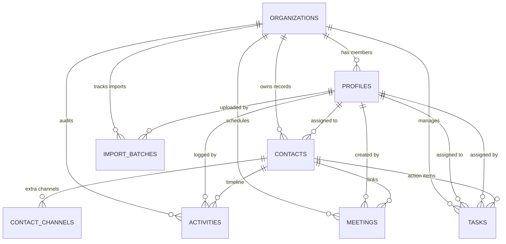

# TeraFlow CRM — Backend & Database Architecture Blueprint

**Document Version:** 1.0.0  
**Target Environment:** PostgreSQL 15+ / Supabase / Next.js 16 (App Router)  
**Author:** Senior Full-Stack Software Architect & Database Engineering Lead  

---

## Executive Summary

TeraFlow CRM is an enterprise-grade, high-velocity customer relationship management system. This document defines the **normalized, production-grade database schema, indexing strategy, access control blueprint (RLS), and API architecture** required to transition from the current frontend mock layer to a live, scalable, sub-millisecond backend.

### Key Architectural Objectives
1. **Sub-Millisecond Indexed Lookups:** Single-digit millisecond query execution for high-frequency search, tag filtering, and pipeline state transitions.
2. **Strict Multi-Tenant Isolation:** Complete logical tenant boundary via `org_id` across every CRM table enforced at the database kernel level (Row-Level Security).
3. **Granular RBAC:** Rigid separation between **Team Lead** (unrestricted tenant administrative power) and **Team Member** (action-gated via explicit permissions with assigned workload scoping).
4. **Zero-Bloat Normalization:** Eliminating redundancy while utilizing PostgreSQL-native `GIN` arrays and `pg_trgm` to avoid unnecessary 3-way join table overhead for tags and fuzzy search.

---

## 1. Normalized Database Schema (PostgreSQL DDL)

The following migration script is 100% production-ready and compatible with Supabase SQL Editor, standard PostgreSQL, and migration runners (Flyway, Liquibase, Supabase CLI).

```sql
-- ═══════════════════════════════════════════════════════════════════════════
-- EXTENSIONS & CORE FUNCTIONS
-- ═══════════════════════════════════════════════════════════════════════════
CREATE EXTENSION IF NOT EXISTS "uuid-ossp";
CREATE EXTENSION IF NOT EXISTS "pg_trgm";

-- Automated updated_at timestamp trigger function
CREATE OR REPLACE FUNCTION set_updated_at()
RETURNS TRIGGER AS $$
BEGIN
    NEW.updated_at = NOW();
    RETURN NEW;
END;
$$ LANGUAGE plpgsql;

-- ═══════════════════════════════════════════════════════════════════════════
-- 1. ORGANIZATIONS (Tenant Boundary)
-- ═══════════════════════════════════════════════════════════════════════════
CREATE TABLE organizations (
    id UUID PRIMARY KEY DEFAULT uuid_generate_v4(),
    name VARCHAR(255) NOT NULL,
    slug VARCHAR(100) UNIQUE NOT NULL,
    created_at TIMESTAMPTZ NOT NULL DEFAULT NOW(),
    updated_at TIMESTAMPTZ NOT NULL DEFAULT NOW()
);

CREATE TRIGGER trg_organizations_updated_at
BEFORE UPDATE ON organizations
FOR EACH ROW EXECUTE FUNCTION set_updated_at();

-- ═══════════════════════════════════════════════════════════════════════════
-- 2. PROFILES (1:1 with Supabase auth.users)
-- ═══════════════════════════════════════════════════════════════════════════
CREATE TYPE user_role AS ENUM ('Team Lead', 'Team Member');
CREATE TYPE user_status AS ENUM ('active', 'invited', 'inactive');
CREATE TYPE theme_mode AS ENUM ('light', 'dark');

CREATE TABLE profiles (
    id UUID PRIMARY KEY REFERENCES auth.users(id) ON DELETE CASCADE,
    org_id UUID NOT NULL REFERENCES organizations(id) ON DELETE CASCADE,
    name VARCHAR(255) NOT NULL,
    email VARCHAR(255) UNIQUE NOT NULL,
    role user_role NOT NULL DEFAULT 'Team Member',
    title VARCHAR(100) DEFAULT '',
    phone VARCHAR(50) DEFAULT '',
    avatar_url TEXT,
    status user_status NOT NULL DEFAULT 'active',
    theme theme_mode NOT NULL DEFAULT 'dark',

    -- Granular Permissions (Team Lead automatically bypasses these)
    can_manage_leads BOOLEAN NOT NULL DEFAULT FALSE,
    can_manage_outreach BOOLEAN NOT NULL DEFAULT FALSE,
    can_manage_tasks BOOLEAN NOT NULL DEFAULT FALSE,
    can_manage_meetings BOOLEAN NOT NULL DEFAULT FALSE,
    can_import_data BOOLEAN NOT NULL DEFAULT FALSE,
    can_export_data BOOLEAN NOT NULL DEFAULT FALSE,

    -- Local UI Memory (Persistent navbar / taskbar sizes)
    ui_preferences JSONB NOT NULL DEFAULT '{"navExpanded": true, "taskbarExpanded": true}'::jsonb,

    created_at TIMESTAMPTZ NOT NULL DEFAULT NOW(),
    updated_at TIMESTAMPTZ NOT NULL DEFAULT NOW()
);

CREATE TRIGGER trg_profiles_updated_at
BEFORE UPDATE ON profiles
FOR EACH ROW EXECUTE FUNCTION set_updated_at();

-- ═══════════════════════════════════════════════════════════════════════════
-- 3. CONTACTS / PEOPLE (Unified CRM Pipeline Entity)
-- ═══════════════════════════════════════════════════════════════════════════
CREATE TYPE contact_stage AS ENUM (
    'New Leads',
    'Contacted',
    'Booked',
    'Closed',
    'Follow-Up',
    'Denied',
    'Past Clients'
);

CREATE TYPE contact_priority AS ENUM ('Low', 'Medium', 'High');

CREATE TABLE contacts (
    id UUID PRIMARY KEY DEFAULT uuid_generate_v4(),
    org_id UUID NOT NULL REFERENCES organizations(id) ON DELETE CASCADE,
    
    business_name VARCHAR(255) NOT NULL,
    contact_name VARCHAR(255) DEFAULT '',
    first_name VARCHAR(100),
    last_name VARCHAR(100),
    
    -- Primary communication channels
    primary_email VARCHAR(255),
    primary_phone VARCHAR(50),
    
    -- Pipeline metadata
    stage contact_stage NOT NULL DEFAULT 'New Leads',
    priority contact_priority NOT NULL DEFAULT 'Medium',
    source VARCHAR(100) NOT NULL DEFAULT 'Cold Outreach',
    deal_value NUMERIC(12, 2) NOT NULL DEFAULT 0.00,
    
    -- Categorization & Segmentation
    niche VARCHAR(100) NOT NULL,
    city VARCHAR(100) NOT NULL,
    tags TEXT[] NOT NULL DEFAULT '{}',
    
    -- Ownership & Notes
    assigned_to UUID REFERENCES profiles(id) ON DELETE SET NULL,
    notes TEXT DEFAULT '',
    
    -- Denormalized cache for fast smart list cards
    last_contacted_at TIMESTAMPTZ,
    last_activity_type VARCHAR(50),
    last_activity_summary TEXT,

    created_at TIMESTAMPTZ NOT NULL DEFAULT NOW(),
    updated_at TIMESTAMPTZ NOT NULL DEFAULT NOW()
);

CREATE TRIGGER trg_contacts_updated_at
BEFORE UPDATE ON contacts
FOR EACH ROW EXECUTE FUNCTION set_updated_at();

-- ═══════════════════════════════════════════════════════════════════════════
-- 4. CONTACT CHANNELS (Normalized Multi-Address / Multi-Phone / Socials)
-- ═══════════════════════════════════════════════════════════════════════════
CREATE TYPE channel_type AS ENUM (
    'phone',
    'email',
    'linkedin',
    'facebook',
    'instagram',
    'website',
    'address'
);

CREATE TABLE contact_channels (
    id UUID PRIMARY KEY DEFAULT uuid_generate_v4(),
    contact_id UUID NOT NULL REFERENCES contacts(id) ON DELETE CASCADE,
    type channel_type NOT NULL,
    label VARCHAR(50) NOT NULL,
    value TEXT NOT NULL,
    is_primary BOOLEAN NOT NULL DEFAULT FALSE,
    created_at TIMESTAMPTZ NOT NULL DEFAULT NOW()
);

-- ═══════════════════════════════════════════════════════════════════════════
-- 5. ACTIVITIES & OUTREACH AUDIT (Timeline, Call Logs, Emails)
-- ═══════════════════════════════════════════════════════════════════════════
CREATE TYPE activity_type AS ENUM (
    'call',
    'email',
    'note',
    'stage_change',
    'contact_info',
    'task'
);

CREATE TABLE activities (
    id UUID PRIMARY KEY DEFAULT uuid_generate_v4(),
    org_id UUID NOT NULL REFERENCES organizations(id) ON DELETE CASCADE,
    contact_id UUID REFERENCES contacts(id) ON DELETE CASCADE,
    author_id UUID NOT NULL REFERENCES profiles(id) ON DELETE CASCADE,
    
    type activity_type NOT NULL,
    title VARCHAR(255) NOT NULL,
    description TEXT DEFAULT '',
    
    -- Call & Email specific attributes
    call_status VARCHAR(50),        -- 'Answered', 'Busy', 'Left Voicemail', etc.
    call_duration_seconds INT,
    email_type VARCHAR(20),         -- 'Sent', 'Reply'
    email_subject VARCHAR(255),
    
    created_at TIMESTAMPTZ NOT NULL DEFAULT NOW()
);

-- ═══════════════════════════════════════════════════════════════════════════
-- 6. MEETINGS
-- ═══════════════════════════════════════════════════════════════════════════
CREATE TYPE meeting_status AS ENUM (
    'Scheduled',
    'Not attended',
    'Deal Done',
    'Deal Denied',
    'Other'
);

CREATE TABLE meetings (
    id UUID PRIMARY KEY DEFAULT uuid_generate_v4(),
    org_id UUID NOT NULL REFERENCES organizations(id) ON DELETE CASCADE,
    contact_id UUID REFERENCES contacts(id) ON DELETE SET NULL,
    created_by UUID NOT NULL REFERENCES profiles(id) ON DELETE CASCADE,
    
    business_name VARCHAR(255) NOT NULL,
    client_name VARCHAR(255) NOT NULL,
    email VARCHAR(255) NOT NULL,
    phone VARCHAR(50) NOT NULL,
    
    meeting_date DATE NOT NULL,
    our_time VARCHAR(50) NOT NULL,      -- Display string e.g. "03:00 PM PKT"
    their_time VARCHAR(50) NOT NULL,    -- Display string e.g. "06:00 AM EST"
    status meeting_status NOT NULL DEFAULT 'Scheduled',
    notes TEXT DEFAULT '',
    meeting_link TEXT,
    
    created_at TIMESTAMPTZ NOT NULL DEFAULT NOW(),
    updated_at TIMESTAMPTZ NOT NULL DEFAULT NOW()
);

CREATE TRIGGER trg_meetings_updated_at
BEFORE UPDATE ON meetings
FOR EACH ROW EXECUTE FUNCTION set_updated_at();

-- ═══════════════════════════════════════════════════════════════════════════
-- 7. TASKS
-- ═══════════════════════════════════════════════════════════════════════════
CREATE TYPE task_status AS ENUM ('TODO', 'COMPLETED');

CREATE TABLE tasks (
    id UUID PRIMARY KEY DEFAULT uuid_generate_v4(),
    org_id UUID NOT NULL REFERENCES organizations(id) ON DELETE CASCADE,
    contact_id UUID REFERENCES contacts(id) ON DELETE SET NULL,
    
    title VARCHAR(255) NOT NULL,
    description TEXT DEFAULT '',
    
    assigned_by UUID NOT NULL REFERENCES profiles(id) ON DELETE CASCADE,
    assigned_to UUID NOT NULL REFERENCES profiles(id) ON DELETE CASCADE,
    
    due_date DATE NOT NULL,
    due_time VARCHAR(10) NOT NULL,      -- HH:mm
    due_at TIMESTAMPTZ NOT NULL,        -- Indexed timestamp for order comparisons
    
    status task_status NOT NULL DEFAULT 'TODO',
    completion_comment TEXT,
    completed_at TIMESTAMPTZ,
    
    created_at TIMESTAMPTZ NOT NULL DEFAULT NOW(),
    updated_at TIMESTAMPTZ NOT NULL DEFAULT NOW()
);

CREATE TRIGGER trg_tasks_updated_at
BEFORE UPDATE ON tasks
FOR EACH ROW EXECUTE FUNCTION set_updated_at();

-- ═══════════════════════════════════════════════════════════════════════════
-- 8. IMPORT BATCHES (Audited Upload History)
-- ═══════════════════════════════════════════════════════════════════════════
CREATE TABLE import_batches (
    id UUID PRIMARY KEY DEFAULT uuid_generate_v4(),
    org_id UUID NOT NULL REFERENCES organizations(id) ON DELETE CASCADE,
    imported_by UUID NOT NULL REFERENCES profiles(id) ON DELETE CASCADE,
    
    filename VARCHAR(255) NOT NULL,
    total_records INT NOT NULL DEFAULT 0,
    successful_records INT NOT NULL DEFAULT 0,
    failed_records INT NOT NULL DEFAULT 0,
    
    default_niche VARCHAR(100),
    default_city VARCHAR(100),
    default_stage contact_stage NOT NULL DEFAULT 'New Leads',
    applied_tags TEXT[] DEFAULT '{}',
    
    created_at TIMESTAMPTZ NOT NULL DEFAULT NOW()
);
```

---

## 2. High-Frequency Indexing Strategy

To guarantee **sub-millisecond execution times** at scale (>500,000 records), the indexes below align with TeraFlow's UI query patterns:

```sql
-- 1. Compound Index for Pipeline Smart Lists & Pagination
-- Solves: WHERE org_id = $1 AND stage = $2 ORDER BY created_at DESC
CREATE INDEX idx_contacts_org_stage_created 
ON contacts (org_id, stage, created_at DESC);

-- 2. Compound Index for Sales Rep / Team Member Filter
-- Solves: WHERE org_id = $1 AND assigned_to = $2 AND stage = $3
CREATE INDEX idx_contacts_org_assigned_stage 
ON contacts (org_id, assigned_to, stage);

-- 3. GIN Array Index for Instant Multi-Tag Filters
-- Solves: WHERE org_id = $1 AND tags @> ARRAY['VIP', 'Warm']
CREATE INDEX idx_contacts_tags_gin 
ON contacts USING GIN (tags);

-- 4. Trigram Fuzzy Search Indexes (Typing ahead in the Search Bar)
-- Solves: WHERE org_id = $1 AND business_name ILIKE '%apex%'
CREATE INDEX idx_contacts_biz_trgm 
ON contacts USING GIN (business_name gin_trgm_ops);

CREATE INDEX idx_contacts_name_trgm 
ON contacts USING GIN (contact_name gin_trgm_ops);

-- 5. Case-Insensitive Functional Indexes for Email & Phone Lookups
-- Solves: Quick deduplication on import and unique contact checking
CREATE INDEX idx_contacts_email_lower 
ON contacts (org_id, LOWER(primary_email));

CREATE INDEX idx_contacts_phone 
ON contacts (org_id, primary_phone);

-- 6. Taskbar Optimization (Urgent Tasks First)
-- Solves: WHERE org_id = $1 AND status = 'TODO' ORDER BY due_at ASC
CREATE INDEX idx_tasks_org_status_due 
ON tasks (org_id, status, due_at ASC);

-- 7. Meetings Calendar & Dashboard conversion view
-- Solves: WHERE org_id = $1 AND meeting_date = CURRENT_DATE ORDER BY our_time ASC
CREATE INDEX idx_meetings_org_date_status 
ON meetings (org_id, meeting_date, status);

-- 8. Activity Timeline (Contact Details Drawer)
-- Solves: WHERE contact_id = $1 ORDER BY created_at DESC
CREATE INDEX idx_activities_contact_created 
ON activities (contact_id, created_at DESC);

-- 9. Contact Channel Multi-Field Lookup
CREATE INDEX idx_contact_channels_contact_id 
ON contact_channels (contact_id);
```

---

## 3. Prisma Schema Equivalent (`prisma/schema.prisma`)

For teams utilizing Prisma ORM with Next.js:

```prisma
datasource db {
  provider = "postgresql"
  url      = env("DATABASE_URL")
}

generator client {
  provider = "prisma-client-js"
}

enum UserRole {
  TEAM_LEAD   @map("Team Lead")
  TEAM_MEMBER @map("Team Member")
}

enum UserStatus {
  active
  invited
  inactive
}

enum ThemeMode {
  light
  dark
}

enum ContactStage {
  NEW_LEADS    @map("New Leads")
  CONTACTED    @map("Contacted")
  BOOKED       @map("Booked")
  CLOSED       @map("Closed")
  FOLLOW_UP    @map("Follow-Up")
  DENIED       @map("Denied")
  PAST_CLIENTS @map("Past Clients")
}

enum ContactPriority {
  Low
  Medium
  High
}

enum ChannelType {
  phone
  email
  linkedin
  facebook
  instagram
  website
  address
}

enum ActivityType {
  call
  email
  note
  stage_change
  contact_info
  task
}

enum MeetingStatus {
  Scheduled
  Not_attended @map("Not attended")
  Deal_Done    @map("Deal Done")
  Deal_Denied  @map("Deal Denied")
  Other
}

enum TaskStatus {
  TODO
  COMPLETED
}

model Organization {
  id         String     @id @default(uuid()) @db.Uuid
  name       String     @db.VarChar(255)
  slug       String     @unique @db.VarChar(100)
  createdAt  DateTime   @default(now()) @map("created_at") @db.Timestamptz
  updatedAt  DateTime   @updatedAt @map("updated_at") @db.Timestamptz

  profiles   Profile[]
  contacts   Contact[]
  activities Activity[]
  meetings   Meeting[]
  tasks      Task[]
  batches    ImportBatch[]

  @@map("organizations")
}

model Profile {
  id            String      @id @db.Uuid
  orgId         String      @map("org_id") @db.Uuid
  name          String      @db.VarChar(255)
  email         String      @unique @db.VarChar(255)
  role          UserRole    @default(TEAM_MEMBER)
  title         String?     @db.VarChar(100)
  phone         String?     @db.VarChar(50)
  avatarUrl     String?     @map("avatar_url")
  status        UserStatus  @default(active)
  theme         ThemeMode   @default(dark)

  // Permissions
  canManageLeads    Boolean @default(false) @map("can_manage_leads")
  canManageOutreach Boolean @default(false) @map("can_manage_outreach")
  canManageTasks    Boolean @default(false) @map("can_manage_tasks")
  canManageMeetings Boolean @default(false) @map("can_manage_meetings")
  canImportData     Boolean @default(false) @map("can_import_data")
  canExportData     Boolean @default(false) @map("can_export_data")
  uiPreferences     Json    @default("{\"navExpanded\": true, \"taskbarExpanded\": true}") @map("ui_preferences")

  createdAt     DateTime    @default(now()) @map("created_at") @db.Timestamptz
  updatedAt     DateTime    @updatedAt @map("updated_at") @db.Timestamptz

  org           Organization @relation(fields: [orgId], references: [id], onDelete: Cascade)
  assignedLeads Contact[]    @relation("AssignedContacts")
  createdTasks  Task[]       @relation("AssignedByTasks")
  assignedTasks Task[]       @relation("AssignedToTasks")
  meetings      Meeting[]
  activities    Activity[]
  importBatches ImportBatch[]

  @@map("profiles")
}

model Contact {
  id               String          @id @default(uuid()) @db.Uuid
  orgId            String          @map("org_id") @db.Uuid
  businessName     String          @map("business_name") @db.VarChar(255)
  contactName      String?         @map("contact_name") @db.VarChar(255)
  firstName        String?         @map("first_name") @db.VarChar(100)
  lastName         String?         @map("last_name") @db.VarChar(100)
  primaryEmail     String?         @map("primary_email") @db.VarChar(255)
  primaryPhone     String?         @map("primary_phone") @db.VarChar(50)
  stage            ContactStage    @default(NEW_LEADS)
  priority         ContactPriority @default(Medium)
  source           String          @default("Cold Outreach") @db.VarChar(100)
  dealValue        Decimal         @default(0.00) @map("deal_value") @db.Decimal(12, 2)
  niche            String          @db.VarChar(100)
  city             String          @db.VarChar(100)
  tags             String[]        @default([])
  assignedTo       String?         @map("assigned_to") @db.Uuid
  notes            String?         @default("")

  lastContactedAt  DateTime?       @map("last_contacted_at") @db.Timestamptz
  lastActivityType String?         @map("last_activity_type") @db.VarChar(50)
  lastActivitySummary String?      @map("last_activity_summary")

  createdAt        DateTime        @default(now()) @map("created_at") @db.Timestamptz
  updatedAt        DateTime        @updatedAt @map("updated_at") @db.Timestamptz

  org              Organization    @relation(fields: [orgId], references: [id], onDelete: Cascade)
  assignee         Profile?        @relation("AssignedContacts", fields: [assignedTo], references: [id], onDelete: SetNull)
  channels         ContactChannel[]
  activities       Activity[]
  meetings         Meeting[]
  tasks            Task[]

  @@index([orgId, stage, createdAt(sort: Desc)])
  @@index([orgId, assignedTo, stage])
  @@map("contacts")
}

model ContactChannel {
  id        String      @id @default(uuid()) @db.Uuid
  contactId String      @map("contact_id") @db.Uuid
  type      ChannelType
  label     String      @db.VarChar(50)
  value     String
  isPrimary Boolean     @default(false) @map("is_primary")
  createdAt DateTime    @default(now()) @map("created_at") @db.Timestamptz

  contact   Contact     @relation(fields: [contactId], references: [id], onDelete: Cascade)

  @@index([contactId])
  @@map("contact_channels")
}

model Activity {
  id                 String       @id @default(uuid()) @db.Uuid
  orgId              String       @map("org_id") @db.Uuid
  contactId          String?      @map("contact_id") @db.Uuid
  authorId           String       @map("author_id") @db.Uuid
  type               ActivityType
  title              String       @db.VarChar(255)
  description        String?
  callStatus         String?      @map("call_status") @db.VarChar(50)
  callDurationSeconds Int?        @map("call_duration_seconds")
  emailType          String?      @map("email_type") @db.VarChar(20)
  emailSubject       String?      @map("email_subject") @db.VarChar(255)
  createdAt          DateTime     @default(now()) @map("created_at") @db.Timestamptz

  org                Organization @relation(fields: [orgId], references: [id], onDelete: Cascade)
  contact            Contact?     @relation(fields: [contactId], references: [id], onDelete: Cascade)
  author             Profile      @relation(fields: [authorId], references: [id], onDelete: Cascade)

  @@index([contactId, createdAt(sort: Desc)])
  @@map("activities")
}

model Meeting {
  id           String        @id @default(uuid()) @db.Uuid
  orgId        String        @map("org_id") @db.Uuid
  contactId    String?       @map("contact_id") @db.Uuid
  createdBy    String        @map("created_by") @db.Uuid
  businessName String        @map("business_name") @db.VarChar(255)
  clientName   String        @map("client_name") @db.VarChar(255)
  email        String        @db.VarChar(255)
  phone        String        @db.VarChar(50)
  meetingDate  DateTime      @map("meeting_date") @db.Date
  ourTime      String        @map("our_time") @db.VarChar(50)
  theirTime    String        @map("their_time") @db.VarChar(50)
  status       MeetingStatus @default(Scheduled)
  notes        String?       @default("")
  meetingLink  String?       @map("meeting_link")
  createdAt    DateTime      @default(now()) @map("created_at") @db.Timestamptz
  updatedAt    DateTime      @updatedAt @map("updated_at") @db.Timestamptz

  org          Organization  @relation(fields: [orgId], references: [id], onDelete: Cascade)
  contact      Contact?      @relation(fields: [contactId], references: [id], onDelete: SetNull)
  creator      Profile       @relation(fields: [createdBy], references: [id], onDelete: Cascade)

  @@index([orgId, meetingDate, status])
  @@map("meetings")
}

model Task {
  id                String     @id @default(uuid()) @db.Uuid
  orgId             String     @map("org_id") @db.Uuid
  contactId         String?    @map("contact_id") @db.Uuid
  title             String     @db.VarChar(255)
  description       String?    @default("")
  assignedBy        String     @map("assigned_by") @db.Uuid
  assignedTo        String     @map("assigned_to") @db.Uuid
  dueDate           DateTime   @map("due_date") @db.Date
  dueTime           String     @map("due_time") @db.VarChar(10)
  dueAt             DateTime   @map("due_at") @db.Timestamptz
  status            TaskStatus @default(TODO)
  completionComment String?    @map("completion_comment")
  completedAt       DateTime?  @map("completed_at") @db.Timestamptz
  createdAt         DateTime   @default(now()) @map("created_at") @db.Timestamptz
  updatedAt         DateTime   @updatedAt @map("updated_at") @db.Timestamptz

  org               Organization @relation(fields: [orgId], references: [id], onDelete: Cascade)
  contact           Contact?     @relation(fields: [contactId], references: [id], onDelete: SetNull)
  assigner          Profile      @relation("AssignedByTasks", fields: [assignedBy], references: [id], onDelete: Cascade)
  assignee          Profile      @relation("AssignedToTasks", fields: [assignedTo], references: [id], onDelete: Cascade)

  @@index([orgId, status, dueAt])
  @@map("tasks")
}

model ImportBatch {
  id                 String       @id @default(uuid()) @db.Uuid
  orgId              String       @map("org_id") @db.Uuid
  importedBy         String       @map("imported_by") @db.Uuid
  filename           String       @db.VarChar(255)
  totalRecords       Int          @default(0) @map("total_records")
  successfulRecords  Int          @default(0) @map("successful_records")
  failedRecords      Int          @default(0) @map("failed_records")
  defaultNiche       String?      @map("default_niche") @db.VarChar(100)
  defaultCity        String?      @map("default_city") @db.VarChar(100)
  defaultStage       ContactStage @default(NEW_LEADS) @map("default_stage")
  appliedTags        String[]     @default([]) @map("applied_tags")
  createdAt          DateTime     @default(now()) @map("created_at") @db.Timestamptz

  org                Organization @relation(fields: [orgId], references: [id], onDelete: Cascade)
  user               Profile      @relation(fields: [importedBy], references: [id], onDelete: Cascade)

  @@map("import_batches")
}
```

---

## 4. Entity Relationship Diagram (ERD)



---

## 5. Row-Level Security (RLS) & Multi-Tenant Blueprint

In Supabase / PostgreSQL, Row-Level Security ensures that even if an attacker attempts to inject a parameter or manipulate an API call, **they cannot read or write data outside their organization or beyond their role privileges**.

```sql
-- 1. Enable RLS on every table
ALTER TABLE organizations ENABLE ROW LEVEL SECURITY;
ALTER TABLE profiles ENABLE ROW LEVEL SECURITY;
ALTER TABLE contacts ENABLE ROW LEVEL SECURITY;
ALTER TABLE contact_channels ENABLE ROW LEVEL SECURITY;
ALTER TABLE activities ENABLE ROW LEVEL SECURITY;
ALTER TABLE meetings ENABLE ROW LEVEL SECURITY;
ALTER TABLE tasks ENABLE ROW LEVEL SECURITY;
ALTER TABLE import_batches ENABLE ROW LEVEL SECURITY;

-- 2. Security Definier Helper: Retrieves authenticated profile in a single cached call
CREATE OR REPLACE FUNCTION get_current_profile()
RETURNS profiles
LANGUAGE sql
STABLE
SECURITY DEFINER
SET search_path = public
AS $$
    SELECT * FROM profiles WHERE id = auth.uid();
$$;

-- 3. PROFILES POLICY
-- Users can read profiles in their org; only Team Lead can insert/update other members' roles/permissions
CREATE POLICY "Profiles Org Isolation" ON profiles
FOR SELECT USING (org_id = (get_current_profile()).org_id);

CREATE POLICY "Team Lead Profile Admin" ON profiles
FOR UPDATE USING (
    org_id = (get_current_profile()).org_id 
    AND (
        (get_current_profile()).role = 'Team Lead' 
        OR id = auth.uid() -- Users can update their own personal info / theme
    )
);

-- 4. CONTACTS POLICY
-- Enforces multi-tenancy + checks granular can_manage_leads permission for Team Members
CREATE POLICY "Contacts MultiTenant Access" ON contacts
FOR ALL USING (
    org_id = (get_current_profile()).org_id
    AND (
        (get_current_profile()).role = 'Team Lead'
        OR (get_current_profile()).can_manage_leads = TRUE
    )
);

-- 5. CONTACT CHANNELS POLICY
CREATE POLICY "Channels Access" ON contact_channels
FOR ALL USING (
    contact_id IN (
        SELECT id FROM contacts 
        WHERE org_id = (get_current_profile()).org_id
    )
);

-- 6. ACTIVITIES POLICY (Call logs, Emails, Notes)
CREATE POLICY "Activities Access" ON activities
FOR ALL USING (
    org_id = (get_current_profile()).org_id
    AND (
        (get_current_profile()).role = 'Team Lead'
        OR (get_current_profile()).can_manage_outreach = TRUE
    )
);

-- 7. MEETINGS POLICY
CREATE POLICY "Meetings Access" ON meetings
FOR ALL USING (
    org_id = (get_current_profile()).org_id
    AND (
        (get_current_profile()).role = 'Team Lead'
        OR (get_current_profile()).can_manage_meetings = TRUE
    )
);

-- 8. TASKS POLICY
CREATE POLICY "Tasks Access" ON tasks
FOR ALL USING (
    org_id = (get_current_profile()).org_id
    AND (
        (get_current_profile()).role = 'Team Lead'
        OR (get_current_profile()).can_manage_tasks = TRUE
        OR assigned_to = auth.uid() -- Members always have access to tasks assigned to them
    )
);
```

---

## 6. API Route Handlers & Data Flow Contract

To avoid over-fetching and eliminate client-side heavy filtering, the API layer is organized into lightweight, cache-friendly Next.js Route Handlers:

```
app/api/
├── dashboard/
│   └── route.ts          # GET: Aggregated KPIs (counts, conversion %, meeting tally) in <5ms
├── contacts/
│   ├── route.ts          # GET: Keyset/Cursor paginated search, filter by stage/niche/city/tag
│   │                     # POST: Atomic creation with channels & initial activity
│   ├── [id]/
│   │   ├── route.ts      # GET: Full Drawer details (contact + channels + activities)
│   │   │                 # PATCH: Stage updates, notes, channel updates
│   │   │                 # DELETE: Soft or hard delete (Team Lead or permitted)
│   │   └── activities/   # POST: Log call or log email
│   └── bulk/             # POST: Bulk tag assignment, bulk stage move, bulk delete
├── meetings/
│   ├── route.ts          # GET: Filtered by date range / status
│   │                     # POST: Schedule new meeting
│   └── [id]/route.ts     # PATCH: Quick status change ('Scheduled' -> 'Deal Done')
├── tasks/
│   ├── route.ts          # GET: Active/completed tasks split
│   │                     # POST: Create task
│   └── [id]/
│       ├── route.ts      # PATCH: Edit title, due date, assignee
│       └── complete/     # POST: Complete task with required completion note
└── team/
    ├── route.ts          # GET: List team members (names/roles)
    │                     # POST: Invite/Add member (Team Lead only)
    └── [id]/route.ts     # PATCH: Update member permissions / role (Team Lead only)
```

### High-Performance Dashboard Aggregation Pattern

Instead of streaming 10,000 lead records over the wire to compute metrics on the browser, the `/api/dashboard` route delegates aggregation directly to the Postgres query planner:

```sql
SELECT 
    COUNT(*) AS total_contacts,
    COUNT(*) FILTER (WHERE stage = 'New Leads') AS new_leads_count,
    COUNT(*) FILTER (WHERE stage = 'Contacted') AS contacted_count,
    COUNT(*) FILTER (WHERE stage = 'Booked') AS booked_meetings_count,
    COUNT(*) FILTER (WHERE stage = 'Closed') AS closed_deals_count,
    COALESCE(SUM(deal_value) FILTER (WHERE stage = 'Closed'), 0) AS total_pipeline_revenue
FROM contacts
WHERE org_id = :orgId;
```

---

## 7. Migration & Rollout Checklist

1. **Database Initialization:** Run the SQL DDL in your Supabase SQL editor or migration runner.
2. **Environment Variables:** Verify `.env.local` contains `NEXT_PUBLIC_SUPABASE_URL` and `NEXT_PUBLIC_SUPABASE_ANON_KEY`.
3. **Database Types:** Run `npx supabase gen types typescript --project-id <id> > types/supabase.ts` to ensure end-to-end compile-time type safety.
4. **CRMContext Integration:** Swap in-memory `useState` mutators with optimistic mutations backed by Supabase client calls.
